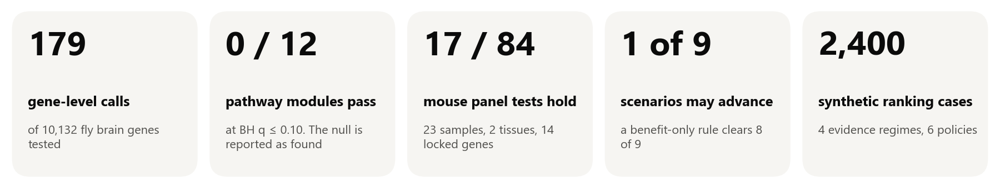
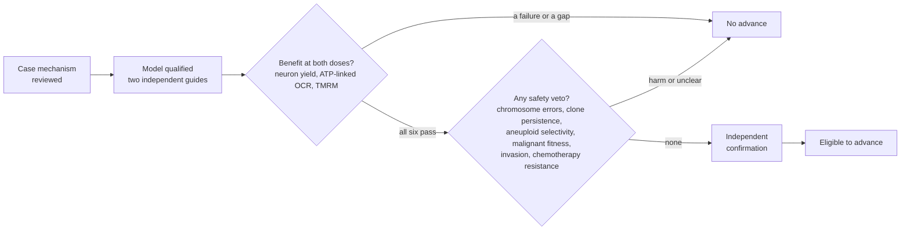
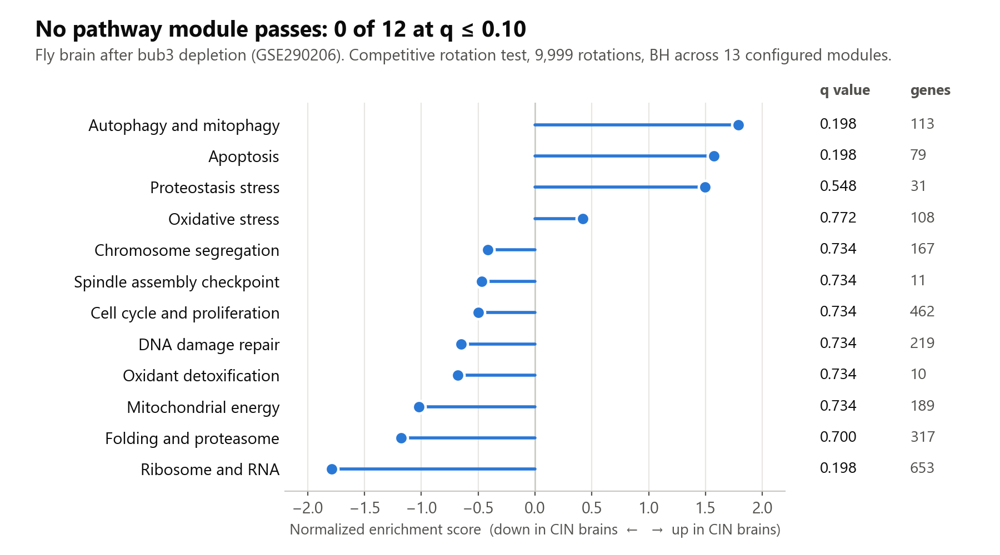
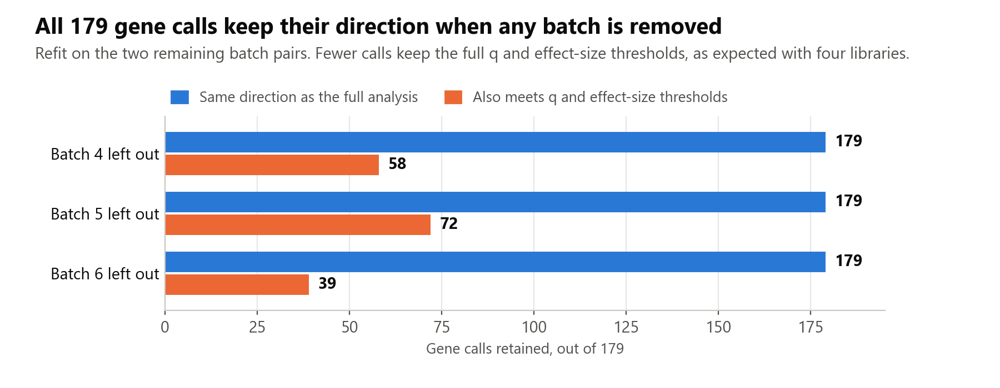
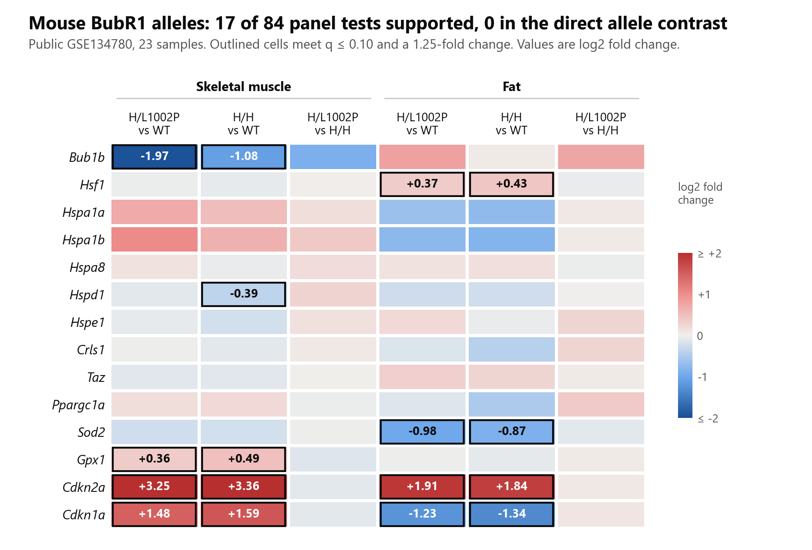
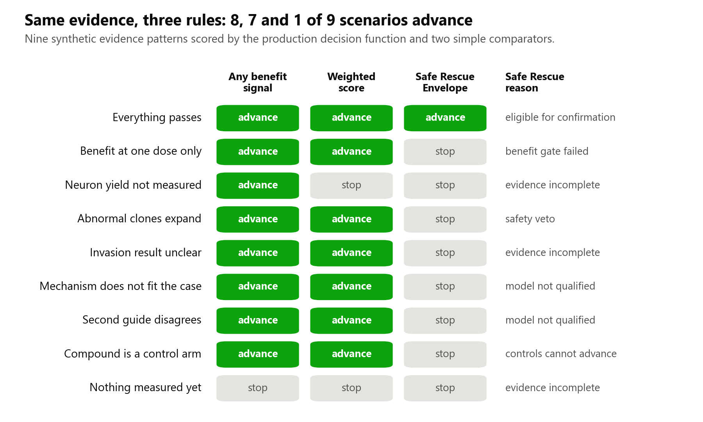
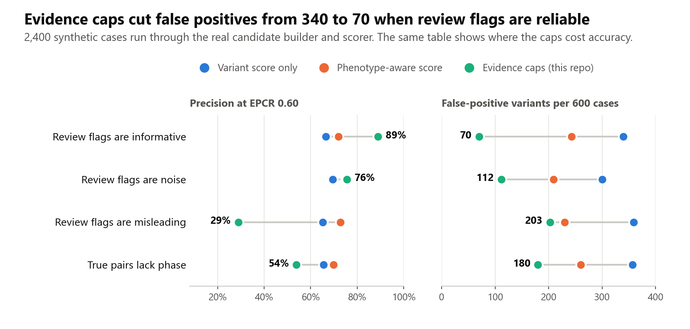
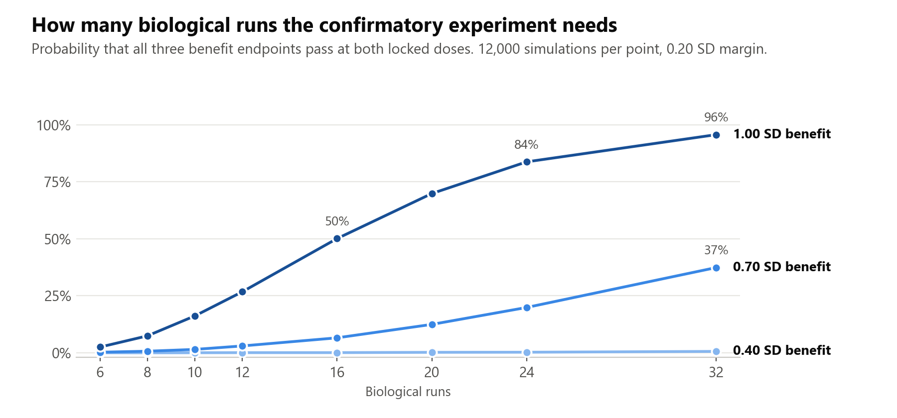

# MVA Safe Rescue

Code and evidence for a hackathon entry on mosaic variegated aneuploidy (MVA): a drug-repurposing decision rule in which safety can veto benefit, three reproducible analyses of public RNA-seq data, and privacy-safe tools for ranking candidate variants.

[](https://github.com/mpvasilis/mva-safe-rescue/actions/workflows/ci.yml)


[](LICENSE)

<picture>
  <source media="(prefers-color-scheme: dark)" srcset="docs/figures/headline-dark.png">
  
</picture>

## Background

MVA is a rare childhood disorder in which dividing cells keep gaining and losing chromosomes. [Rare Disease, Real Kid: the 2026 MVA Hackathon](https://sagebio-rare-disease-real-kid-mva-hackathon-2026.hf.space/) gave teams one child's genome and clinical record under controlled access and asked two questions. Track 1: which variant causes the disease? Track 2: which approved medicine deserves a laboratory test?

This repository is the public half of the MVA Safe Rescue entry. It holds code, results from public data and synthetic test fixtures. The child's data never entered it, and a path-based privacy scan in CI keeps it that way.

## The idea

In a disease of chromosome instability, a compound that helps stressed cells survive may be protecting the abnormal clones. A published fly experiment makes the risk concrete. Rapamycin raised the number of aneuploid neural stem cells in a checkpoint-deficient brain, yet differentiated neurons and brain size did not recover. A screen that scores survival alone would record that as a rescue.

The Safe Rescue Envelope is a rule for deciding when a compound may move forward. Neural output and two independent mitochondrial readouts have to improve at both tested doses. Six safety gates can each stop the compound, and an unclear safety result counts as a stop. Benefit and harm are never averaged into one score.



Two compounds are eligible under this rule: arimoclomol, which acts on proteostasis, and elamipretide, which acts on mitochondrial function. Sirolimus, everolimus and acetylcysteine run alongside as controls and cannot advance. The 16 gates are in [SAFE_RESCUE_ENVELOPE.tsv](docs/SAFE_RESCUE_ENVELOPE.tsv) and the experiment is specified in [CONFIRMATORY_EXPERIMENT_DESIGN.md](docs/CONFIRMATORY_EXPERIMENT_DESIGN.md).

## Results

| Question | Answer |
|---|---|
| Does the fly brain transcriptome point at a pathway to drug? | No. 0 of 12 modules reach q ≤ 0.10, and the lowest q is 0.198. |
| Are the 179 gene calls stable? | All 179 keep their direction in every leave-one-batch-out refit. |
| Do mouse BubR1 alleles show one coherent stress response? | No. 17 of 84 panel tests pass, the pattern changes with tissue, and none is in the direct allele contrast. |
| Does the decision rule behave differently from a score? | It advances 1 of 9 synthetic scenarios. A weighted score advances 7 and a benefit-only rule 8. |
| Do evidence caps improve variant ranking? | They cut false positives from 340 to 70 when review flags are informative, and cost accuracy when the flags mislead. |

### The fly brain transcriptome does not pick a drug

<picture>
  <source media="(prefers-color-scheme: dark)" srcset="docs/figures/fly-modules-dark.png">
  
</picture>

Paired RNA-seq from fly brains with a depleted spindle checkpoint ([GSE290206](https://www.ncbi.nlm.nih.gov/geo/query/acc.cgi?acc=GSE290206), six libraries in three batch pairs) gives 179 gene-level calls out of 10,132 genes tested. Bub3 goes down, and the Hsp70 family and GstE8 go up. At pathway level, none of the 12 evaluable modules reaches BH q ≤ 0.10 in a competitive rotation test with 9,999 rotations. The module list, thresholds and seed were locked before the run, so the pipeline reports the null and stops there. No drug is nominated from expression data.

Full tables: [analysis/track2/release](analysis/track2/release/README.md).

### Gene calls keep their direction when a batch is removed

<picture>
  <source media="(prefers-color-scheme: dark)" srcset="docs/figures/fly-influence-dark.png">
  
</picture>

Dropping any one batch pair and refitting leaves all 179 calls pointing the same way. Between 39 and 72 of them also keep the full significance and effect-size thresholds on the four remaining libraries. Shrunken fold changes correlate with the full analysis at Spearman 0.73 to 0.94 across all 10,132 genes.

### Mouse BubR1 alleles add tissue context

<picture>
  <source media="(prefers-color-scheme: dark)" srcset="docs/figures/mouse-panel-dark.png">
  
</picture>

A second, independent dataset ([GSE134780](https://www.ncbi.nlm.nih.gov/geo/query/acc.cgi?acc=GSE134780), 23 mouse samples across three BubR1 genotypes and two tissues) was analyzed under a protocol hashed before any counts were read. A fixed panel of 14 genes across six contrasts makes 84 tests, and 17 meet both thresholds. The pattern depends on tissue: Cdkn1a rises in muscle and falls in fat. No test in the direct allele comparison passes, and the heat-shock and cardiolipin genes show no coherent response, so neither candidate moves up on this evidence.

Protocol and full panel: [analysis/external/GSE134780](analysis/external/GSE134780/README.md).

### The decision rule against two simpler rules

<picture>
  <source media="(prefers-color-scheme: dark)" srcset="docs/figures/decision-rules-dark.png">
  
</picture>

The decision function is ordinary Python in [src/rare_mva/track2/decision.py](src/rare_mva/track2/decision.py). Fed nine synthetic evidence patterns, a rule that accepts any benefit signal advances eight of them, and a weighted score (80% benefit, 20% safety) advances seven. Safe Rescue advances one, the scenario in which everything passes, and returns the reason for every stop. The tests check each safety veto against all 64 combinations of the six benefit results.

### Variant ranking under good and bad evidence

<picture>
  <source media="(prefers-color-scheme: dark)" srcset="docs/figures/ranking-policy-dark.png">
  
</picture>

A Track 1 submission ranks up to ten candidate variants by estimated probability of causal relationship (EPCR). The builder in this repository caps that probability when reads are unvalidated, population frequency is unknown or compound phase is unresolved. A stress test on 2,400 synthetic cases runs the real builder and scorer against two simpler scoring policies. When review flags carry information, the caps cut false-positive variants from 340 to 70 and lift precision from 67% to 89%, with top-3 recovery at 94%. When the flags are noise or misleading the caps cost accuracy, and the benchmark reports those regimes in the same table.

Protocol and tables: [analysis/benchmarks](analysis/benchmarks/README.md).

### Planning the confirmatory experiment

<picture>
  <source media="(prefers-color-scheme: dark)" srcset="docs/figures/design-power-dark.png">
  
</picture>

A simulation of the benefit gates (72 scenarios, 12,000 runs each) shows what the all-endpoints rule costs in sample size. With a true benefit of 1.00 SD, 24 biological runs give an 84% chance that all three endpoints pass at both doses. At 0.70 SD, 32 runs give 37%.

Assumptions and the full grid: [analysis/design_power](analysis/design_power/README.md).

## Quick start

The Python package needs only the standard library at runtime.

```console
git clone https://github.com/mpvasilis/mva-safe-rescue.git
cd mva-safe-rescue
python -m venv .venv
.venv/bin/python -m pip install -e ".[dev]"
python -m pytest -q
python analysis/benchmarks/run.py
```

On Windows, use `.venv\Scripts\python` in place of `.venv/bin/python`.

Try the Track 1 tools on the synthetic fixtures:

```console
python -m rare_mva validate-track1 tests/fixtures/valid_single.csv
python -m rare_mva score-track1 tests/fixtures/valid_compound.csv tests/fixtures/ground_truth.json
python -m rare_mva privacy-scan .
```

The R analyses are CPU only and use R 4.6 with Bioconductor 3.23. The fly pipeline downloads its inputs by manifest and verifies checksums first:

```console
Rscript analysis/track2/bootstrap.R
Rscript analysis/track2/run.R --validate-only --download
Rscript analysis/track2/tests/testthat.R
Rscript analysis/track2/run.R
```

The mouse panel:

```console
python analysis/external/GSE134780/fetch.py
Rscript analysis/external/GSE134780/run.R
```

To redraw the figures on this page from the released tables:

```console
python -m pip install -e ".[figures]"
python analysis/figures/make_readme_figures.py
```

## What is in the repository

| Path | Contents |
|---|---|
| [src/rare_mva](src/rare_mva) | Python package: Track 1 schema, candidate builder, scorer and privacy scan, plus the Safe Rescue decision function |
| [analysis/track2](analysis/track2/README.md) | Fly brain pipeline in R with config, tests and sealed results |
| [analysis/external/GSE134780](analysis/external/GSE134780/README.md) | Mouse panel analysis and its locked protocol |
| [analysis/external/GSE185192](analysis/external/GSE185192/README.md) | Human trisomy 21 neural context, kept as an appendix |
| [analysis/benchmarks](analysis/benchmarks/README.md) | Decision and ranking policy comparisons |
| [analysis/design_power](analysis/design_power/README.md) | Power simulation for the confirmatory design |
| [analysis/secure_wgs](analysis/secure_wgs/README.md) | Whole-genome workflow for rented secure compute: provider gate, signed plans, cleanup verification and a mosaic aneuploidy scan, all tested on synthetic data |
| [analysis/environment](analysis/environment/README.md) | renv lockfiles pinning 121 R packages each |
| [docs](docs) | Reports, protocol, candidate dossier, claim ledger and the 16-gate envelope |
| [tests](tests) | 363 Python tests on synthetic fixtures |

Where to start reading:

- [One-page brief](docs/JUDGES_BRIEF.md) and the [final report](docs/TRACK2_FINAL_REPORT.md)
- [Detailed report](docs/REPORT_DRAFT.md) with the full methods and the human-neural appendix
- [Protocol and dated amendment](docs/TRACK2_PROTOCOL.md)
- [Candidate rationale](docs/CANDIDATE_RATIONALE.md), the [scorecard](docs/CANDIDATE_SCORECARD.tsv) and the [mechanism bridge](docs/MECHANISM_BRIDGE.md)
- [Claim ledger](docs/CLAIM_LEDGER.tsv): 55 claims, each tied to a source and a falsifier
- [Literature search protocol](docs/CANDIDATE_SEARCH_PROTOCOL.md) and its [machine-readable log](docs/CANDIDATE_SEARCH_LOG.tsv)

## Track 1 tools

`rare-mva` is a small command-line package for the last step of a variant submission.

```console
python -m rare_mva privacy-scan [ROOT]
python -m rare_mva build-track1 CANDIDATES.json OUTPUT.csv [--public-root ROOT] [--quiet]
python -m rare_mva validate-track1 SUBMISSION.csv [--expected-proband-id ID] [--quiet]
python -m rare_mva score-track1 SUBMISSION.csv GROUND_TRUTH.json
```

Every command prints compact, deterministic JSON. A submission must use this exact header:

```text
proband_id,chrom_1,pos_1,ref_1,alt_1,chrom_2,pos_2,ref_2,alt_2,epcr,finding_type,notes
```

The validator accepts 1 to 10 rows with one shared proband ID, chromosomes named `chr1` to `chr22`, `chrX`, `chrY` or `chrM`, positive positions and uppercase alleles. EPCR must lie in `(0, 1]` and must not increase down the file. Second-variant fields are all blank or all filled, and duplicate candidate sets are rejected even when a compound pair is listed in the other order.

The builder turns a candidate JSON into that CSV and applies the caps. EPCR is held at 0.80 while calibration is synthetic only, 0.75 when reads are not validated, 0.55 when compound phase is unresolved and 0.50 when population frequency is unknown. The lowest cap wins. Phase is supplied explicitly and never inferred, and `cis` pairs are rejected. Output is written atomically and only outside the public checkout, with symlinks and Windows reparse points refused.

The scorer follows the published challenge rules: 100 points for a full match at rank 1, 50 at ranks 2 to 3, 25 at ranks 4 to 5 and 10 at ranks 6 to 10, with half credit for one matching variant of a two-variant truth, and F-max over EPCR thresholds.

While writing it we found a mismatch in the official scoring. The challenge FAQ says secondary findings cannot affect the automated score, but the published evaluator parses `finding_type` and never filters on it, so secondary rows count toward both rank points and F-max. A [compatibility test](tests/test_scoring.py) reproduces the executable behavior. See the [runbook](docs/TRACK1_LOCAL_RUNBOOK.md) and the [reproducibility map](docs/TRACK1_REPRODUCIBILITY_MAP.md) for the full workflow.

## Reproducibility

- Three sealed result releases carry SHA-256 inventories covering 61 artifacts. `python analysis/verify_releases.py` rechecks every byte count and hash.
- Public inputs are fetched from GEO and FlyBase by manifest and checked against pinned checksums. Downloaded data is never committed.
- Seeds are fixed, and two renv lockfiles pin the R environment at 121 packages each.
- CI runs the Python suite on Ubuntu and Windows with Python 3.11 and 3.12. A second workflow reruns the R pipelines from freshly downloaded public data.
- The figures on this page are drawn straight from the released tables by [one script](analysis/figures/make_readme_figures.py).

## Scope

The analyses use public fly, mouse and human cell-line data. They say nothing about the child's diagnosis and make no claim about treatment, dose or efficacy in MVA. Arimoclomol and elamipretide are hypotheses for a laboratory screen. The case-specific work for Track 1 ran in a separate controlled environment and is not part of this repository. [DATA_GOVERNANCE.md](DATA_GOVERNANCE.md) sets out the boundary, and [DELETION_RUNBOOK.md](DELETION_RUNBOOK.md) covers what to do if it is ever crossed.

## Acknowledgement

> This work was made possible through the Hackathon, organized by Sage Bionetworks in partnership with the MVA Society, Hugging Face, and BEACON (The Benchmarking, Evaluation, and Assessment Consortium for Science), with prize sponsorship from AWS and Anthropic. We are deeply grateful to the child and their family who generously contributed their data and their story to advance research into this rare disease. We acknowledge their trust in making this Hackathon possible.

## License

[Creative Commons Attribution 4.0 International](LICENSE) (CC BY 4.0). Read [CONTRIBUTING.md](CONTRIBUTING.md) before opening a pull request.
